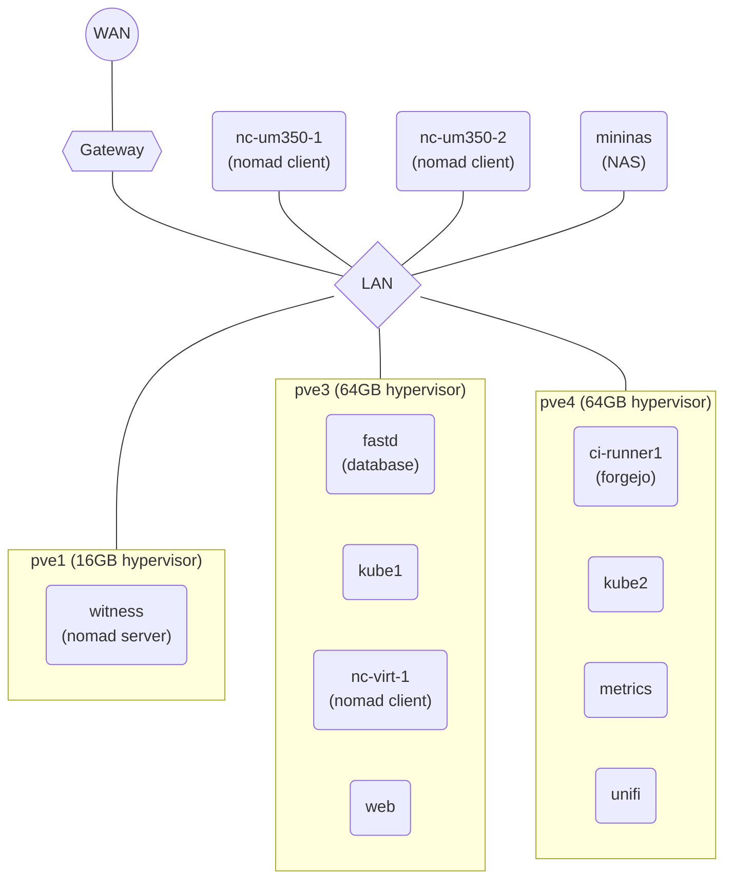
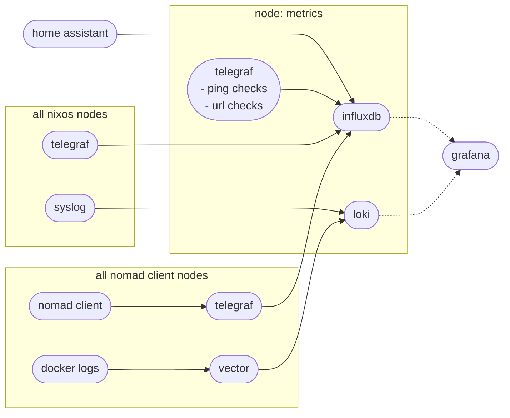

# homelab

- `ansible`: My ansible config to capture telemetry and syslogs from Raspberry
  Pis.
- `bin`: Ops scripts: `deploy` a host, `dns-sync` to push DNS zones,
  `gen_passwords` to render secrets templates.
- `consul`: Consul ACL policies.
- `esphome`: My esphome (ESP32 + Home Assistant) configs.
- `flake-modules`: flake-parts modules wiring up hosts, packages and the
  dev shell for the root `flake.nix`.
- `nomad`: Nomad job specs, ACL policies, helper scripts, and the cluster
  CA material under `certs/`.
- `nixos`: My NixOS home lab system configs.
- `pkgs`: Nix packages owned by this repo, exposed via the flake and as an
  overlay to hosts.

## Usage

Enter the dev shell with direnv or `nix develop`, then:

- `nixos-rebuild --flake .#<host> build` — validate/build a host config
- `bin/deploy <host> [root@<target>]` — build and push to a running host
- `bin/dns-sync` — build and push DNS zones (octodns; see `nixos/confgen`)
- `nix build .#confgen` — regenerate config outputs (DNS zone YAML, etc)

## Diagrams

### Machines

### Monitoring

